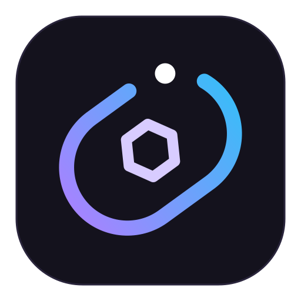
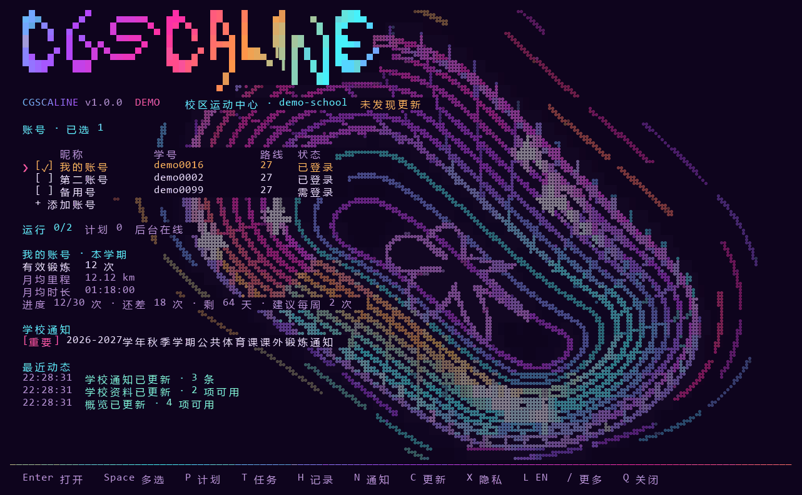

#  cgscaline

[简体中文](./README.md) · English

A small terminal client for CGSport (`cgsport` + `mescaline`).

Built to queue and submit runs in the background, check semester progress, and read campus notices. Key hints are shown at the bottom of each screen, and closing the terminal window leaves the background worker running for scheduled tasks.



## Usage

If you grab the standalone `cgscaline.exe` from Releases on Windows, just double-click it — no Node.js installation needed.

Running from source or building the executable yourself requires **Windows + Node.js 22.19+** (credentials and libraries are encrypted via Windows DPAPI under `%LOCALAPPDATA%\CGSPORT\terminal-v1`; other OSes can run `--demo`):

```powershell
npm ci
npm run build
npm start -- --en  # launch TUI in English
npm run build:exe  # bundle standalone release\cgscaline.exe
```

To preview offline without an account, run `npm run demo:en` (or `cgscaline.exe --demo --en`).

## Getting Started

1. **Select Campus & Sign In**: Add an account, search your university from the built-in directory (server endpoint and venue boundary rules are fetched automatically), and sign in.
2. **Import Runs**: Open Track Libraries and press `P` to pull from a USB-connected Android phone via ADB, or press `I` to select `ygty_mysport.db` / an Android backup archive (`.bak` / `.zip`) — decrypted automatically with zero external scripts.
3. **Run or Schedule**: Open One-Shot to preview and submit, or press `P` on the home screen to schedule a time window.

## Notes & License

Currently supports standard GPS + accelerometer routes. Routes requiring live facial photo verification or dynamic per-run random checkpoints are flagged in the UI and not bypassed — PRs from students at other campuses are welcome.

Shared for personal study and reference under the [MIT License](./LICENSE).
