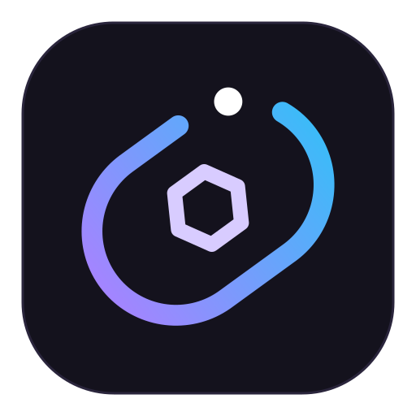

#  cgscaline

简体中文 · [English](./README.en.md)

一个跑在终端里的 CGSport 小工具，名字拼自 `cgsport` + `mescaline`。

平时挂后台按计划交记录、查学期次数和学校通知用的，顺手做了个带动态背景和轨迹预览的终端界面。底部自带当前页面的按键说明，关掉窗口后后台进程会继续跑排好的任务。


## 运行

如果在 Releases 下载了单文件 `cgscaline.exe`，在 Windows 上直接双击即可打开（无需安装 Node 环境）。

从源码运行或自行打包需要 **Windows + Node.js 22.19+**（账号与本地记录通过系统 DPAPI 加密存放在 `%LOCALAPPDATA%\CGSPORT\terminal-v1`；其他系统可加 `--demo` 看离线演示界面）：

```powershell
npm ci
npm run build
npm start          # 启动界面
npm run build:exe  # 打包独立单文件 release\cgscaline.exe
```

想先不联网看一眼效果可以直接跑 `npm run demo`（或 `cgscaline.exe --demo`）。

## 首次使用

1. **选学校并登录**：打开后添加账号，直接搜索选择自己的学校（自动从官方接口拉取服务地址与场地围栏规则）并登录。
2. **导入运动记录**：进入「记录库」，按 `P` 连接开启了 USB 调试的安卓手机自动提取，或按 `I` 直接选择导出的 `ygty_mysport.db` / 手机本地备份包（`.bak` / `.zip`，内置自动解密，无需额外脚本）。
3. **开始或排计划**：回到账号页即可生成预览轨迹并立即开始，或在主页按 `P` 排定时计划。

## 说明

目前仅面向常规 GPS + 传感器的跑步路线；若学校某条路线开启了强制人脸拍照核验或动态随机抽点，界面会给出提示（暂不支持绕过，欢迎其他学校同学提 PR）。

个人日常自用小工具，仅供学习交流，采用 [MIT License](./LICENSE)。
